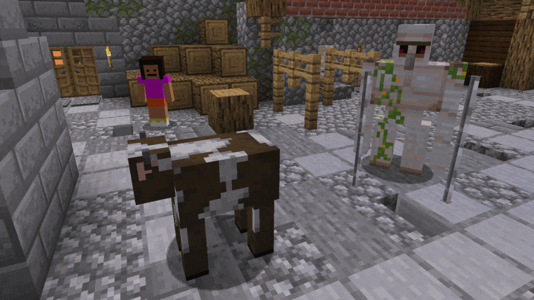
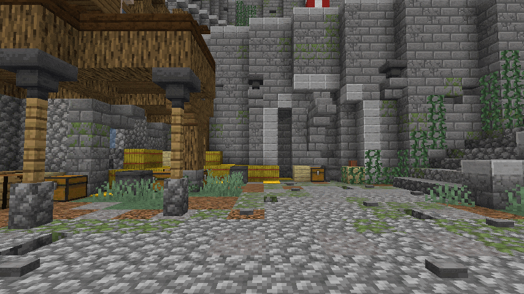

# GlowingEntities


An util to easily set glowing entities (or blocks) per-player on a Spigot server.

No ProtocolLib, no dependency, compatible from Minecraft 1.17 to 26.3!





## How to install?
Add this requirement to your maven `pom.xml` file:

```xml
<dependency>
  <groupId>fr.skytasul</groupId>
  <artifactId>glowingentities</artifactId>
  <version>{VERSION}</version>
  <scope>compile</scope>
</dependency>
```
Then, configure the maven shade plugin to relocate the classes location. You can also use the Spigot library resolver to download the library, or Paper's plugin loader.

> [!NOTE]
> Until 1.3.4, the util was under the groupId `io.github.skytasul`.<br>
> After 1.3.5, it has changed to `fr.skytasul`.

> [!IMPORTANT]
> When initializing the `GlowingEntities` object, the server must have at least 1 world loaded.
> If your plugin's load strategy in *plugin.yml* is `STARTUP`, you have to wait until a world has loaded in before initializing `GlowingEntities`.
> If your load strategy is `POSTWORLD` (the default load strategy), you can initialize it immediately.

## How to use?
### Make entities glow
1. Initialize the `GlowingEntities` object somewhere where you can easily get it, using `new GlowingEntities(plugin)`.
It is not recommended to create multiple `GlowingEntities` instances!

2. Use `GlowingEntities#setGlowing(Entity entity, Player receiver, ChatColor color)` to make an entity glow a color for a player!

3. You can change its glowing color by reusing the same method but changing the `color` parameter.

4. If you no longer wants your entity to glow, use `GlowingEntities#unsetGlowing(Entity entity, Player receiver)`.

5. When you are completely done with the glowing API (for instance, when your plugin is shutting down), remember to use `GlowingEntities#disable()`.

### Make blocks glow
1. Initialize `new GlowingBlocks(plugin)` on a Paper-based server.

2. Call `setGlowing(block, receiver, color)` with a `Block` or `Location` and a `ChatColor`.
   On Minecraft 1.19.4 and newer, partial blocks use their BlockDisplay model.
   Full blocks, air, liquids and older versions use a Shulker cube outline.

3. Use `setGlowingShulker(location, receiver, color)` for a cube outline or
   `setGlowingDisplay(block, receiver, color)` (1.19.4+) for the block model.
   Use `setGlowingDisplay(location, blockData, receiver, color)` to display a chosen state, including in the air.
   The state is copied and kept across chunk reloads. Pass `null` for `blockData` to use the world block.
   Display methods also accept an RGB `Color` and an optional `Display.Brightness`.
   By default, Display brightness is estimated from exposed sides. It can look different from the original block,
   especially for full blocks, because the entire model shares one brightness setting.

4. Call `unsetGlowing(block, receiver)` to remove the effect, and `disable()` when you are done with the API.

### Advanced usage (fake entities)
If you want to make fake entities glow (= entities that do not really exist in the world, i.e. that don't have Bukkit Entity instances), you'll have to use the `setGlowing(EntityIdentifier entity, String teamID, Player receiver, ChatColor color, byte otherFlags)` method.

The `EntityIdentifier` instance is what allows GlowingEntities to track which entity to make glow by providing an accurate entity ID (EID). Since the EID of an entity can change during its lifespan (e.g. when changing world), you have to carefully craft an `EntityIdentifier` implementation.

If your fake entity is a simple one that keeps the same entity ID and does not change worlds, you can use the pre-made implementation: `new EntityIdentifierEID(entityId, world)`.
